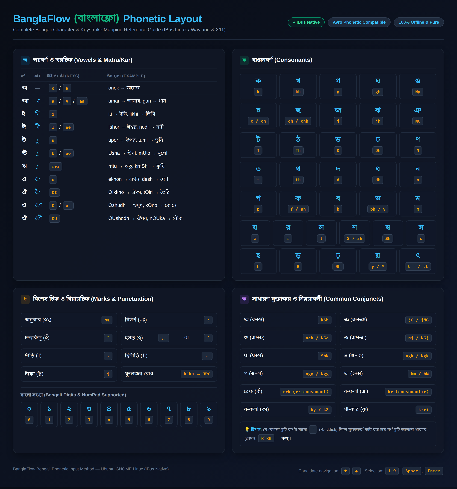

# BanglaFlow (বাংলাফ্লো)

Native Bengali phonetic input method for Linux (IBus).

[](LICENSE)
[]()
[]()

BanglaFlow is a native, lightweight, and system-wide Bengali phonetic input method designed specifically for Linux desktop environments (GNOME Wayland/X11). It provides accurate Banglish-to-Bengali conversion directly within any application without background key-sniffing daemons or simulated backspace hacks.

---

## Features

- **Longest-Match Phonetic Tokenizer**: High-precision context-aware parsing of phonetic rules (e.g. `ami` → `আমি`, `bangla` → `বাংলা`, `banglay` → `বাংলায়`, `bhaSha` → `ভাষা`).
- **Pure-Python Architecture**: Completely decoupled text-processing engine, state machine, and dictionary with zero GUI dependencies in the core.
- **Strict Bengali Unicode Compliance**: Enforces logical code point order without blind normalization (preserves precomposed `ড়`, `ঢ়`, `য়`).
- **Interactive Preedit & Suggestions**: Native underline preedit with frequency-ranked candidate lookup table.
- **Offline & Privacy-First**: Zero network calls, zero telemetry, zero typed keystrokes in logs.
- **Atomic Commits**: Single-press Space and Enter commit candidate words cleanly without duplicate spaces or characters.

---

## Supported Environments

| Environment | Release | Status |
| :--- | :--- | :--- |
| **Ubuntu Desktop** | 26.04 LTS (resolute) | **TESTED** |
| **Ubuntu Desktop** | 24.04 LTS (noble) | **TESTED** |
| **GNOME Shell (Wayland)** | Default Ubuntu session | **TESTED** |
| **GNOME Shell (X11)** | X11 fallback session | **TESTED** |
| **GTK 3 / GTK 4 Apps** | Native Linux apps | **TESTED** |
| **Web Browsers** | Chrome / Chromium / Firefox | **TESTED** |

---

## Installation

### From Debian Package (.deb)

1. Download or build the `.deb` package:
   ```bash
   sudo dpkg -i banglaflow.deb
   sudo apt-get install -f
   ```

2. Restart the IBus daemon:
   ```bash
   ibus restart
   ```

3. Enable in GNOME:
   - Go to **Settings** → **Keyboard** → **Input Sources**.
   - Click **Add (+)** → **...** (more) → search **Bengali**.
   - Select **BanglaFlow** and click **Add**.

---

## Phonetic Typing Reference Guide

Complete reference map for all Bengali vowels (স্বরবর্ণ), consonants (ব্যঞ্জনবর্ণ), vowel signs/kar (কার), conjuncts (যুক্তাক্ষর), digits (সংখ্যা), and punctuation:



### Quick Reference & Examples

| English Input | Bengali Output | Notes |
| :--- | :--- | :--- |
| `ami` | `আমি` | Basic vowel + consonant |
| `bangla` | `বাংলা` | Anusvara (`ng` → `ং`) |
| `banglay` | `বাংলায়` | Precomposed `য়` (`U+09DF`) |
| `likhi` | `লিখি` | Dependent vowel signs |
| `bhaSha` | `ভাষা` | Retroflex `ষ` |
| `amar` | `আমার` | Independent `আ` |
| `torrko` | `তর্ক` | Reph (`rr` before consonant) |
| `brriShTi` | `বৃষ্টি` | Ri-kar (`rri`) + conjunct |
| `Taka $500.` | `টাকা ৳৫০০।` | Auto currency (`৳`) and Dari (`।`) |

---

## Uninstallation

To remove:
```bash
sudo dpkg -r banglaflow
```

To purge all files:
```bash
sudo dpkg -P banglaflow
```

---

## Bug Reporting Template

When reporting an issue, please include the following environment details:

```text
=== System Info ===
OS: $(lsb_release -d)
Desktop: $XDG_CURRENT_DESKTOP ($XDG_SESSION_TYPE)
IBus Version: $(ibus version)
Python: $(python3 --version)
BanglaFlow Version: 1.0.0

=== Issue Description ===
Input string: [e.g. "somporrko"]
Expected output: [e.g. "সম্পর্ক"]
Actual output: [e.g. "সম্পরক"]
Application: [e.g. GNOME Text Editor / Chrome / Terminal]
```

---

## License

BanglaFlow is licensed under the [GNU General Public License v3.0](LICENSE).
Phonetic rule tables derived from OmicronLab under MPL-2.0.
Dictionary wordlists derived from LibreOffice under MPL-2.0 / LGPL-3.0.

